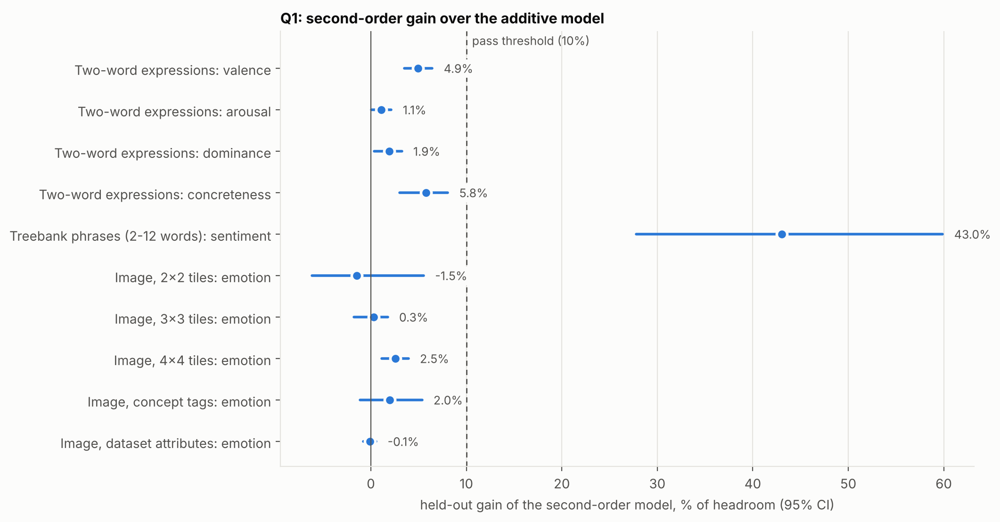
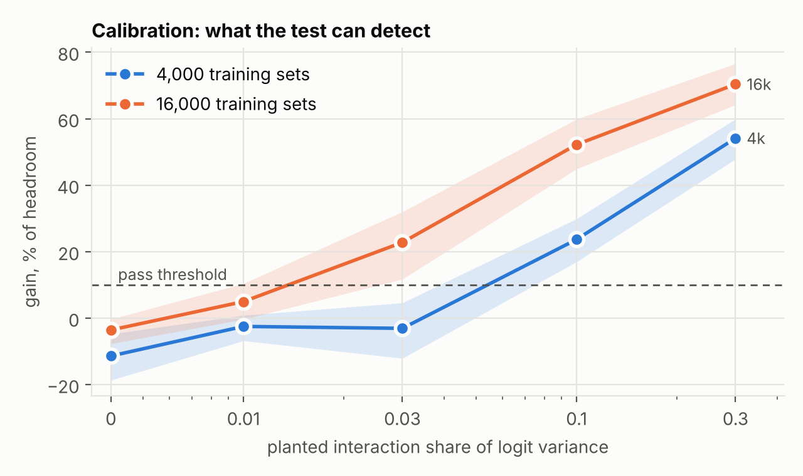
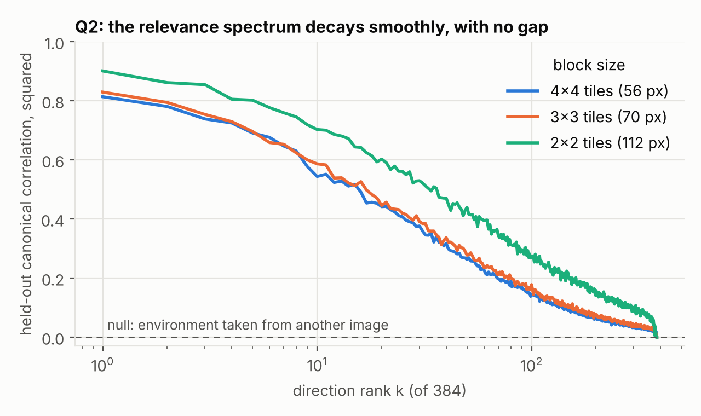
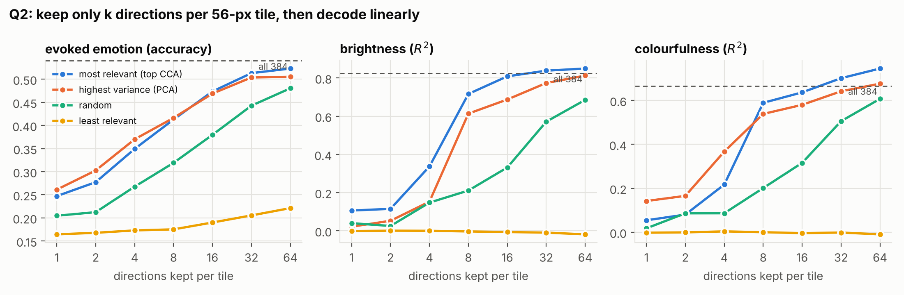

# Results — first pass

> Follow-up: the operator/particle structure found here, and per-user couplings, are tested in `RESULTS_2.md`. One statement below is refined there: the operator effect is not confined to a few words (a short list gives about half of it).

Run on 2026-11-13, CPU only (4 vCPU, no GPU was available). Every number below is held-out, with a 95% interval from a paired bootstrap over items and seeds. Raw outputs are in `docs/results/`; `scripts/make_tables.py` regenerates the tables and `scripts/make_figures.py` the figures.

## 1. Verdict

**Q1 — do body orders $\ge 2$ beat the additive model?** Depends on the test bed.

| test bed | labels | second-order gain $\Delta_2$ | share of headroom | pass rule |
|---|---|---|---|---|
| Phrases of 2–12 words (sentiment treebank) | human | +0.044 [+0.028, +0.061] | 43% | **passes** (lenient ceiling, see 3.3) |
| Two-word expressions: valence | human | +0.021 [+0.015, +0.027] | 4.9% | fails |
| Two-word expressions: arousal, dominance | human | +0.006, +0.009 | 1–2% | fails |
| Two-word expressions: concreteness | human | +0.014 [+0.008, +0.020] | 5.8% | fails |
| Images, 2×2 isolated tiles: evoked emotion | human | −0.001 [−0.003, +0.003] | −1.5% | fails (null) |
| Images, 3×3 isolated tiles | human | +0.001 [−0.003, +0.003] | 0.3% | fails (null) |
| Images, 4×4 isolated tiles | human | +0.008 [+0.003, +0.012] | 2.5% | fails |
| Images, named concept tags | human (tags from CLIP) | +0.003 [−0.002, +0.008] | 2.0% | fails (null) |
| Images, dataset attributes | human (attributes machine-made) | −0.001 [−0.005, +0.003] | −0.1% | fails (null) |

$\Delta_2$ is in units of label variance for the language rows and in nats of cross-entropy for the image rows.

- The interaction is real in language and grows with the number of words. It is small for pairs and absent or tiny for image parts.
- Where it exists, it is **sparse and operator-like**: a handful of words ("not", "no", "false", "low") carry about half of the gain. It is not a generic pair potential between objects.
- A **gated additive model**, with one-body functions only (each word has a value and a multiplicative factor on the total), reproduces the whole second-order gain on the treebank: +0.045 [+0.030, +0.061] against +0.044. The factors it learns single out negators without supervision (section 3.4).
- Most of what the additive model misses is **not** recovered by any order of interaction among the given one-body descriptors. It is information the descriptors lack (idioms such as "bad egg"; objects cut by a tile border).

Against the kill criterion as worded ("no significant gain from order $\ge 2$"): not met, since the gain is significant in language. Against the pass rule: met only on the treebank, where the ceiling is lenient. My reading is in section 6.

**Q2 — does a learned coarse-graining give a small, stable set of relevant directions?** No.

- The relevance spectrum decays smoothly. There is no gap: 54–112 directions have held-out $\rho^2 > 0.25$, and no two successive values differ by more than a factor 1.09.
- The directions are stable (top-8 subspace overlap 0.87–0.92 between disjoint halves, against 0.02 by chance). So the answer is "stable, but not small".
- The conjecture "abstract concepts are the relevant directions, sensory detail is irrelevant" fails in its second half: global brightness and colour sit in the *most* relevant directions, more firmly than emotion does.

## 2. What was run, and deviations from the proposal

| | proposal | done |
|---|---|---|
| E0 | synthetic calibration | done |
| E1 | Affection ∩ Visual Genome | **not done**: Affection is form-gated and needs your request. Replaced by the open test beds below. |
| Language | not planned | NRC VAD v2.1 two-word expressions (10,071), concreteness norms (44,475 two-word expressions), Stanford Sentiment Treebank (155,197 phrases, 215,387 tree nodes) |
| Images | planned for later | EmoSet-118K: the 17,716-image test split, cross-fitted. Validation and train were not used for Q1 (extraction ran at about 3–5 images/s on CPU). |
| Q2 | gated on Q1 | run anyway, since it needed no extra data: 20,669 images (test + part of validation) |
| Compute | GPU from week 3 | none available: the container has no GPU and no cloud GPU credentials were provided |
| Per-user couplings (brief §3.3) | stub | untested: no open dataset here carries annotator identities |
| Gated additive model | not planned | added after seeing where the interaction sits (3.4) |
| Network | — | hosts allowed for this work: huggingface.co and its CDN (us.aws.cdn.hf.co), download.pytorch.org (+ download-r2), saifmohammad.com, Visual Genome and COCO hosts (allowed, unused so far) |

Objects are always embedded **in isolation**, so the order-1 model is truly one-body: single words (GloVe or MiniLM, each word encoded alone), single image tiles (DINOv2 ViT-S/14, each tile passed alone), single tag words. Features taken from a whole-image or whole-sentence encoder already contain interactions and would make the test meaningless; those are used only as any-order references.

All models share one skeleton, $z = g(N)\,[\,W A + \text{higher}(A)\,] + b(N)$ with $A=\frac1N\sum_i\phi(x_i)$. The size functions $g, b$ are available to every model, so a normalisation effect is never counted as an interaction. "ACE form" means a low-rank polynomial readout of $A$ of degree 2 or 3; it was the form named in the proposal and is the one the pass rule is applied to. An explicit pair model, Deep Sets and a Set Transformer are reported alongside.

## 3. Q1 in detail

### 3.1 Calibration (E0)

Synthetic sets with a planted pair term that is Hoeffding-pure (zero additive component), nine classes, six simulated annotators per item.

| training sets | planted share $\eta$ of logit variance | $\Delta_2$ | % of headroom | passes |
|---|---|---|---|---|
| 4,000 | 0 | −0.0020 [−0.0034, −0.0009] | −11% | no |
| 4,000 | 0.03 | −0.0009 [−0.0034, +0.0013] | −3% | no |
| 4,000 | 0.1 | +0.0118 [+0.0085, +0.0149] | 24% | yes |
| 16,000 | 0.01 | +0.0008 [−0.0001, +0.0016] | 5% | no |
| 16,000 | 0.03 | +0.0047 [+0.0024, +0.0065] | 23% | yes |
| 16,000 | 0.1 | +0.0256 [+0.0220, +0.0293] | 52% | yes |

- False positives: 0 of 8 null datasets pass, and none has a lower bound above 0.
- Sensitivity: an interaction carrying 10% of logit variance is found with 4,000 sets, 3% with 16,000, 1% is not found at 16,000.
- In synthetic data the headroom is nearly all interaction. In real data it is mostly missing information, so "10% of headroom" is a much stricter bar there.

### 3.2 Two-word expressions

Human norms for the expression; each word is one object. Five-fold cross-fitting, five seeds (concreteness: three folds, three seeds).

| word features | node | additive $R^2$ | $\Delta_2$ (ACE form) | noise-ceiling $R^2$ | % of headroom |
|---|---|---|---|---|---|
| GloVe | valence | 0.578 | +0.0206 [+0.0147, +0.0268] | 0.995 | 4.9% |
| GloVe | arousal | 0.465 | +0.0058 [+0.0003, +0.0112] | 0.990 | 1.1% |
| GloVe | dominance | 0.528 | +0.0086 [+0.0017, +0.0146] | 0.980 | 1.9% |
| MiniLM | valence | 0.570 | +0.0226 [+0.0152, +0.0303] | 0.995 | 5.3% |
| GloVe + human word norms | valence | 0.636 | +0.0159 [+0.0097, +0.0216] | 0.995 | 4.4% |
| MiniLM | concreteness | 0.570 | +0.0143 [+0.0075, +0.0200] | 0.819 | 5.8% |

- Roughly half of an expression's affect follows additively from its words. Allowing the two words to interact adds about two points of $R^2$ for valence and less for the rest.
- A sentence encoder reading the whole expression is no better than the additive model for affect (MPNet: valence +0.032, arousal 0, dominance −0.028). For concreteness it is better (+0.041 [+0.036, +0.047]), which also shows that my fitted second-order models do not exhaust what two words can jointly express.
- The additive baseline is not under-fitted in embedding space: tripling its capacity and training time leaves valence $R^2$ at 0.575–0.578.

**Model-free variant.** Inputs are only the human norms of each word (V, A, D, concreteness); gradient boosting with and without cross-word interactions.

| target | node | order-1 $R^2$ | order-2 $R^2$ | $\Delta_2$ |
|---|---|---|---|---|
| affect (n = 8,289) | valence | 0.619 | 0.618 | −0.0006 [−0.0066, +0.0056] |
| | arousal | 0.472 | 0.450 | −0.0226 [−0.0298, −0.0163] |
| | dominance | 0.540 | 0.529 | −0.0114 [−0.0175, −0.0050] |
| concreteness (n = 36,015) | concreteness | 0.567 | 0.555 | −0.0122 [−0.0143, −0.0102] |

In the space of human norms there is no interaction at all. The 40–50% of variance left over is not a function of the words' norms; it needs word identity. Examples the additive model gets most wrong: "bad egg", "treasure trove", "great disgust", "low cost".

### 3.3 Sentiment treebank

Every node of every parse tree has a human rating, so one dataset gives sets of 2–12 words and a real hierarchy.

**One coarse-graining step, human labels only.** Predict a parent's sentiment from its two children's sentiments (136,838 training nodes, 38,116 test nodes).

| inputs | additive $R^2$ | interacting $R^2$ | gain |
|---|---|---|---|
| children's sentiment | 0.610 | 0.623 | +0.0136 [+0.0119, +0.0154] |
| + children's lengths | 0.610 | 0.636 | +0.0266 [+0.0243, +0.0288] |

About 36% of the parent's variance is not carried by the children's sentiment at all. Label noise is unknown here, so part of that is noise. The one-dimensional sentiment variable is not closed under this step.

**Words as a set** (60,000 training phrases, 20,000 test phrases, three seeds; each word has its embedding, its own human sentiment and its relative position).

| model | body order | $R^2$ | $\Delta$ vs additive | % of headroom |
|---|---|---|---|---|
| additive | 1 | 0.483 | | |
| ACE form, degree 2 | $\le 2$ | 0.526 | +0.0438 [+0.0282, +0.0609] | 43% |
| ACE form, degree 3 | $\le 3$ | 0.534 | +0.0513 [+0.0331, +0.0700] | 50% |
| Deep Sets | any | 0.539 | +0.0565 [+0.0391, +0.0785] | 56% |
| Set Transformer | any | 0.525 | +0.0429 [+0.0258, +0.0600] | 42% |
| whole phrase through MPNet | any, with word order | 0.584 | +0.1016 [+0.0858, +0.1194] | 100% |

| phrase length | 2 | 3 | 4–5 | 6–8 | 9–12 |
|---|---|---|---|---|---|
| $\Delta_2$ | +0.011 [−0.002, +0.023] | +0.038 [+0.022, +0.052] | +0.049 [+0.029, +0.070] | +0.077 [+0.049, +0.111] | +0.058 [+0.021, +0.096] |

- This is the one test bed that passes. The caveat: there is no noise ceiling for these labels, so headroom is measured to the best any-order reference, which is easier to reach than a noise ceiling.
- Third order adds little beyond second (+0.008). The series converges fast.
- The run without the word-sentiment feature was killed for lack of memory and has not been repeated, so I cannot say how much of the gain depends on that feature.
- Prior art: that composition matters on this dataset is the classic result of Socher et al. (EMNLP 2013), whose model composes children with a tensor (a second-order term) and whose headline claim is handling negation. Verified in `PRIOR_ART.md`, section 2b.

### 3.4 Where the interaction sits

For valence of two-word expressions, per-item gain of the second-order model:

- The top 5% of expressions carry 48–52% of the total gain; the gain is positive for only 51% of items.
- By first word (mean gain, in units of label variance): "not" 1.31, "no" 0.93, "false" 0.45, "low" 0.40, "poor" 0.33.
- Top items: "not negative", "hate crime", "no disgust", "great disgust", "no nonsense", "no joy", "not bad", "no problem".

These words do not contribute a value; they act on the other word's value (sign flip, attenuation). In the language of the expansion, $\phi^{(2)}$ is concentrated on pairs that contain one of a small set of operator-like elements.

**Direct test: a gated additive model.** $z = \big[\prod_j m(x_j)\big]\,\frac1N\sum_i \phi(x_i)$, with $m = 1 + 2\tanh\delta(x) \in (-1, 3)$ and $\delta = 0$ at initialisation. It has no pair parameters.

| test bed | additive $R^2$ | gated additive, $\Delta$ vs additive | ACE degree 2, $\Delta$ vs additive |
|---|---|---|---|
| Treebank phrases, 2–12 words | 0.483 | +0.0449 [+0.0300, +0.0609] | +0.0438 [+0.0282, +0.0609] |
| Treebank, 2 words | | +0.026 [+0.018, +0.033] | +0.011 [−0.002, +0.023] |
| Treebank, 6–8 words | | +0.077 [+0.051, +0.108] | +0.077 [+0.049, +0.111] |
| Two-word expressions, valence (GloVe) | 0.578 | +0.0084 [+0.0026, +0.0143] | +0.0208 [+0.0139, +0.0279] |

- On the treebank the gated model equals the generic second-order model, and is better for two-word phrases.
- On the NRC two-word expressions it recovers about 40% of the second-order gain. Those expressions are mostly lexicalised compounds ("hate crime", "problem solver") rather than modifier + head, so less of the gain has operator form.

Learned factors for the 934 words seen at least 25 times (mean of three seeds):

| factor $m$ | words |
|---|---|
| 0.0–0.25 | n't (0.01), not (0.11), never (0.14), no (0.18), nor (0.21) |
| 0.35–0.65 | without (0.36), less (0.38), need (0.42), lack (0.50), lacking (0.58), impossible (0.60), barely (0.64), neither (0.64) |
| within 0.1 of 1 | 60% of words |
| largest | year (1.35), filmmaking (1.30), big (1.26), completely (1.23), most (1.22) |

- About 1% of the vocabulary has $m < 0.5$. No word has $m < 0$: negation damps the total toward neutral rather than flipping it.
- Seed-to-seed standard deviation of the factors for the strongest negators is 0.2–0.4, so the ranking is firm but the exact values are not.

### 3.5 Images (EmoSet, evoked emotion, 8 classes)

17,716 images, five-fold cross-fitting, three seeds. Ceiling for the pass rule: an MLP on the whole-image DINOv2 embedding (cross-entropy 0.742, accuracy 73.4%). A whole-image CLIP embedding reaches 0.595 and 78.4%.

| objects (each embedded alone) | additive: loss (accuracy) | $\Delta_2$, ACE degree 2 | $\Delta_3$, ACE degree 3 | Deep Sets | Set Transformer | $\Delta_2$ as % of headroom |
|---|---|---|---|---|---|---|
| 2×2 tiles, 112 px | 0.798 (71.1%) | −0.0008 [−0.0034, +0.0031] | +0.0005 [−0.0023, +0.0047] | −0.0134 | −0.0277 | −1.5% |
| 3×3 tiles, 70 px | 0.931 (66.8%) | +0.0005 [−0.0034, +0.0033] | +0.0019 [−0.0017, +0.0053] | −0.0044 | −0.0109 | 0.3% |
| 4×4 tiles, 56 px | 1.042 (63.0%) | +0.0076 [+0.0034, +0.0118] | +0.0037 [−0.0024, +0.0089] | +0.0093 | −0.0190 | 2.5% |
| 8 concept tags: text embedding + human word norms | 0.887 (68.0%) | +0.0028 [−0.0016, +0.0078] | −0.0005 [−0.0045, +0.0038] | −0.0212 | −0.0093 | 2.0% |
| 8 concept tags: human word norms only | 1.184 (58.0%) | +0.0186 [+0.0121, +0.0252] | +0.0068 [−0.0035, +0.0175] | +0.0023 | +0.0150 | 4.2% |
| EmoSet's own attributes (1–8 per image) | 1.315 (51.0%) | −0.0006 [−0.0045, +0.0032] | −0.0033 [−0.0072, +0.0000] | −0.0119 | +0.0003 | −0.1% |

Positive $\Delta$ means better than additive. The explicit pair model was run for 2×2 tiles only: +0.0036 [−0.0025, +0.0107]. Concept tags are the eight nearest concrete nouns (out of 2,095 with human norms) under CLIP similarity.

- With word norms as the only description of each tag, the ACE form gains +0.019, but Deep Sets does not, and this is the low-dimensional regime where my additive network is known to under-fit (see caveats). I treat it as unconfirmed.
- EmoSet's own attributes (scene, objects, facial expression, action, brightness, colourfulness) show no interaction either, but they are a thin description: scene is missing for 77% of images and 47% have no object listed.

- At the 2×2 scale emotion is additive over isolated quadrants to within noise.
- At the 4×4 scale a small second-order gain appears, 2.5% of headroom.
- The whole-image encoder beats every set model on isolated tiles. That gap cannot be closed by interactions among tile summaries; it is information lost when a tile is embedded alone (objects and faces cut by a border, lower effective context).
- Tiles are not objects. This test says affect is nearly additive over *image regions*, not over *things*. The object-level test still needs Affection ∩ Visual Genome.

**Confirmatory run on the official split** (added 2026-11-14): 31,494 training images, 5,905 validation, the same 17,716 test images, three seeds. Whole-image DINOv2 ceiling: cross-entropy 0.692, accuracy 74.6%.

| objects | additive: loss (accuracy) | $\Delta_2$, ACE degree 2 | Deep Sets | gated additive | $\Delta_2$ as % of headroom |
|---|---|---|---|---|---|
| 2×2 tiles | 0.738 (73.5%) | −0.0003 [−0.0028, +0.0022] | −0.0025 [−0.0118, +0.0047] | −0.0214 [−0.0276, −0.0157] | −0.7% |
| 3×3 tiles | 0.853 (69.0%) | +0.0003 [−0.0074, +0.0068] | +0.0046 [−0.0028, +0.0115] | −0.0267 [−0.0398, −0.0134] | 0.2% |
| 4×4 tiles | 0.956 (65.8%) | +0.0098 [+0.0062, +0.0136] | +0.0108 [+0.0045, +0.0172] | −0.0390 [−0.0520, −0.0276] | 3.7% |
| 8 concept tags | 0.833 (69.7%) | −0.0070 [−0.0233, +0.0048] | −0.0064 [−0.0155, +0.0022] | −0.0204 [−0.0328, −0.0097] | −4.9% |

With more than twice the training data per model the picture is unchanged: null at 2×2, 3×3 and for tags; a small significant gain at 4×4 that stays far below the pass threshold; and no operator structure.

## 4. Q2 in detail

Linear version of RSMI: canonical correlation between a tile's embedding and its environment (the surrounding tiles), fitted on 14,468 images, re-measured on 6,201 held-out images. In the linear-Gaussian case the ordered canonical directions are the information-bottleneck solution, and $\rho_k^2$ is the relevance spectrum.

| block | top $\rho^2$ | directions with $\rho^2 > 0.25$ | with $\rho^2 > 0.05$ | participation ratio (of 384) | largest $\rho^2_k/\rho^2_{k+1}$, $k \le 40$ | null, max $\rho^2$ | top-8 subspace overlap (chance) |
|---|---|---|---|---|---|---|---|
| 4×4 tiles, 56 px | 0.81 | 54 | 236 | 122 | 1.09 | 0.0004 | 0.92 (0.02) |
| 3×3 tiles, 70 px | 0.83 | 58 | 264 | 131 | 1.08 | 0.0007 | 0.87 (0.02) |
| 2×2 tiles, 112 px | 0.90 | 112 | 369 | 173 | 1.07 | 0.0006 | 0.89 (0.02) |

**Truncation test.** Keep $k$ directions per 56-px tile, chosen four ways, then decode linearly.

| $k$ | emotion accuracy: most relevant | highest variance (PCA) | random | least relevant | relevant − PCA | brightness $R^2$: relevant | PCA | colourfulness $R^2$: relevant | PCA |
|---|---|---|---|---|---|---|---|---|---|
| 2 | 0.277 | 0.303 | 0.212 | 0.168 | −0.025 [−0.037, −0.013] | 0.12 | 0.05 | 0.08 | 0.17 |
| 8 | 0.413 | 0.416 | 0.319 | 0.175 | −0.004 [−0.015, +0.007] | 0.72 | 0.61 | 0.59 | 0.54 |
| 16 | 0.474 | 0.469 | 0.380 | 0.190 | +0.005 [−0.007, +0.016] | 0.81 | 0.69 | 0.64 | 0.58 |
| 64 | 0.523 | 0.505 | 0.480 | 0.221 | +0.018 [+0.007, +0.030] | 0.85 | 0.81 | 0.75 | 0.68 |

Chance accuracy is 0.125 to 0.17 (classes are unbalanced). All 384 directions give 0.540, 0.82 and 0.67.

- Emotion is absent from the least relevant directions (near chance) and present in the relevant ones. That half of the conjecture holds.
- Ordering by relevance is no better than ordering by variance for emotion, and worse when very few directions are kept ($k \le 4$).
- Brightness is recovered *better* from the relevant directions than emotion is (88% of its full value at $k=8$, against 68% of emotion's above-chance accuracy). Global illumination and colour are long-range correlated, so RSMI ranks them as highly relevant.
- Two coarse-graining steps (4×4 → 2×2 → image) change nothing: accuracy after step 2 is 0.402 / 0.465 / 0.520 with relevance-chosen directions and 0.406 / 0.451 / 0.518 with PCA, for $k$ = 8 / 16 / 32. The top $\rho^2$ stays at 0.82–0.83, with no sharpening.

Two bugs were found and fixed before these numbers: a float16 overflow in standardisation, and a spurious correlation from per-position mean appearance (sky at the top), which had inflated the null to $\rho^2 = 0.22$.

## 5. Reading in physics terms

1. **The one-body term dominates and the series converges fast.** Order 2 captures most of what any order captures; order 3 adds under a point. This is the regime where a cluster expansion is useful, but also where it has little to say beyond mean field.
2. **The pair term is not a pair potential.** It is concentrated on a few elements that act multiplicatively on their partner. A split into "particles" carrying values and "operators" acting on them, $a = \big[\prod_j m(x_j)\big]\sum_i\phi(x_i)$ with $m \approx 1$ for almost all elements, fits the treebank as well as a generic $\phi^{(2)}$ does (3.4).
3. **The larger deficit is in the particle list, not in the interactions.** "Bad egg" is not a bound state computable from "bad" and "egg"; it is a separate entry. No body order fixes a missing degree of freedom.
4. **RSMI relevance measures spatial correlation length, not abstraction.** Anything shared across the scene is relevant: semantics, affect, and also illumination. To separate abstract from sensory one needs a second axis, such as invariance under changes of appearance.
5. **No scale separation is visible.** A smooth spectrum over three block sizes is what one expects away from any fixed point. The RG vocabulary (relevant, irrelevant, exponents) is not supported by these data beyond analogy.

## 6. Recommendation

Neither stop nor continue as planned.

- The broad claim, that meaning emerges from many-body combination of object activations, is weakly supported: it holds in language at a few points of variance, and not for image regions.
- The specific finding worth pursuing is the operator/particle structure in point 2. A first test already supports it on the treebank and partly on two-word expressions (3.4). It is directly usable in the venture engine: additive rendering plus a short, learnable list of modifiers. Open questions: whether images have any analogue of an operator (the tile and tag tests found none), and whether the factors are personal.
- The object-level image test is still open and needs the gated data.

## 7. Caveats

- One-body features come from pretrained encoders. GloVe and MiniLM carry corpus statistics; the tags come from CLIP. Labels are human throughout.
- The fitted second-order models do not exhaust the second-order class (3.2). The explicit pair model was often worse than the ACE form, an optimisation issue rather than a finding.
- The neural additive model under-fits low-dimensional norm inputs (gradient boosting is 6–8 points better). The neural "norms only" run in `docs/results/e1_vad_norms_rated.json` therefore overstates the interaction and is not used above.
- NRC reliability figures are for the whole lexicon, not the two-word subset.
- Treebank: three seeds, default hyper-parameters selected, lenient ceiling.
- Images: the cross-fitted runs use 15% of EmoSet and the confirmatory runs 47%; single label per image, tiles instead of objects, ceiling defined by a model rather than by annotator noise.
- Q2 is a linear approximation on encoder features with three scales.
- EmoSet was taken from a third-party Hugging Face mirror (`Woleek/EmoSet-118K`); its licence is unconfirmed. NRC VAD is for non-commercial research only.

## 8. Needed next

1. Request Affection (and optionally EMOTIC, also form-gated and non-commercial); both give object-level tests.
2. Done in part on 2026-11-14: a confirmatory fixed-split run with 31,494 training images (section 3.5). The remaining 63K images would need about three more CPU-hours and are unlikely to change the conclusion.
3. A decision on the operator/particle follow-up in section 6.
4. Persistent storage: cached features (about 0.5 GB so far) live only in this container; everything is reproducible from the scripts.
