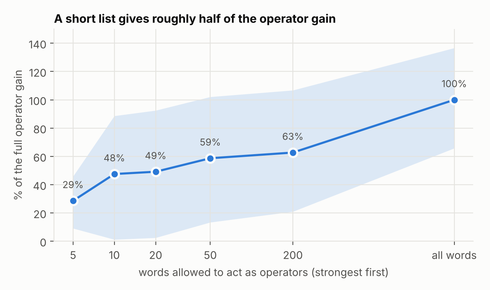

# Results — second pass: operators and particles

Run on 2026-11-14, CPU only. This pass follows the decision to narrow to the operator/particle structure found in `RESULTS.md`. Every number is held-out with a 95% paired-bootstrap interval; raw outputs are in `docs/results/` (`e1c_*anatomy*`, `e1c_*ablate*`, `e5_operators.json`, `e5b_short_list.json`, `e4_*.json`, `e2_*_gate_*`).

The model under test, for objects $x_i$ with one-body value $\phi(x_i)$ and one-body factor $m(x_i)$:

$$z=\Big[\prod_j m(x_j)\Big]\,\frac1N\sum_i W\phi(x_i),\qquad m(x)=1+2\tanh\delta(x)\in(-1,3)$$

"Gate" below means this model; $m=1$ is a particle with no operator action.

## 1. Summary

**Operators (the narrowed question).**

- On sentiment, the operator form accounts for the whole low-order interaction: adding a generic pair term on top gains +0.003 [−0.016, +0.018].
- Operators act forward. Backward-acting ones give no significant gain.
- The effect has a sparse head and a diffuse tail: the ten strongest words (never, without, n't, less, not, nor, no, …) recover roughly half of it when the model is refitted with them alone, though the interval is wide; the rest needs small factors on thousands of words.
- The factors transfer: frozen treebank factors work as well on a second dataset as factors learned there, and shuffled ones hurt.
- It is specific to valence in language. Arousal, dominance and concreteness show no operator structure; image tiles and tags show none.
- On categorical emotions (GoEmotions) a multiplicative gain exists (+0.030 to +0.057) but it is a different mechanism: the low factors belong to emotion words themselves, not to negators.

**Per-user couplings (brief §3.3), tested for the first time.**

- A rater-specific field on the concept nodes gains +0.127 nats per rating on held-out comments; adding a rater-specific response strength, +0.157; adding a rank-4 personal readout of content, +0.218. With rater identities shuffled the gain is 0.000.
- On the same scale, operators gain +0.032. **Personalisation is four to seven times larger than the best combination rule.**
- About 20 ratings from a person already match the operator gain; 50 double it.
- Operator strength is a reliable personal trait (split-half $r$ = 0.80–0.85 across 62 raters) but explains almost nothing (+0.001 to +0.003).

## 2. Anatomy on the sentiment treebank

60,000 training phrases of 2–12 words, 20,000 held-out, three seeds. Additive $R^2$ = 0.483.

| model | what it adds to the additive model | gain over additive |
|---|---|---|
| gate | commuting one-body factors | +0.0449 [+0.0300, +0.0609] |
| ordered gate, forward | a factor acts only on words after it | +0.0448 |
| ordered gate, backward | a factor acts only on words before it | +0.0128 [−0.0013, +0.0263] |
| ACE degree 2 | generic pair term | +0.0438 [+0.0282, +0.0609] |
| gate + ACE degree 2 | both | +0.0476 [+0.0285, +0.0679] |
| Deep Sets | any order | +0.0565 [+0.0391, +0.0785] |
| whole phrase through MPNet | any order, with word order and pretraining | +0.1016 [+0.0858, +0.1194] |

Paired differences:

| comparison | difference |
|---|---|
| gate + pair term over gate | +0.0028 [−0.0155, +0.0179] |
| forward-ordered over commuting gate | 0.0000 [−0.0070, +0.0064] |
| commuting gate over backward-ordered | +0.0321 [+0.0266, +0.0379] |
| gate over ACE degree 2 | +0.0011 [−0.0041, +0.0060] |
| Deep Sets over gate | +0.0116 [+0.0037, +0.0197] |
| whole-phrase MPNet over gate + pair term | +0.0540 [+0.0399, +0.0676] |

- **No pair structure is detectable once operators are in.** The generic second-order term and the operator form explain the same variance.
- **Operators act forward.** Restricting a factor to the words that follow it loses nothing; restricting it to the words before it loses about 70% of the gain. At these phrase lengths the commuting product is therefore as good as the ordered one.
- **The gain does not depend on the human word-sentiment feature.** Without it: additive $R^2$ 0.447, gate +0.0405, ACE degree 2 +0.0398.
- **About half of the structure a sentence encoder captures is still missing** (+0.054 beyond gate + pair). That part is neither operator-like nor a low-order set interaction in these descriptors.

## 3. How short can the operator list be?

Words are ranked by $|m-1|$ in the unrestricted model (words seen at least 25 times). The model is then refitted with only the top $k$ words allowed to carry a factor.

| operator words allowed | share of test tokens | gain over additive | share of the full gate's gain |
|---|---|---|---|
| 5 | 0.7% | +0.0128 [+0.0041, +0.0206] | 29% |
| 10 | 0.9% | +0.0213 [+0.0005, +0.0397] | 48% |
| 20 | 1.1% | +0.0220 [+0.0011, +0.0415] | 49% |
| 50 | 1.9% | +0.0263 [+0.0060, +0.0458] | 59% |
| 200 | 7.1% | +0.0281 [+0.0094, +0.0479] | 63% |
| all | 100% | +0.0449 [+0.0295, +0.0613] | 100% |

Learned factors of the top-ranked words: never −0.06, without −0.02, n't 0.04, less 0.09, not 0.10, nor 0.15, no 0.22, need 0.28, hardly 0.30, hate 0.34, rarely 0.40, devoid 0.45, none 0.46, barely 0.47, lack 0.49, only 0.53, neither 0.56; huge 1.47.

- **A sparse head and a diffuse tail.** Ten words give about half of the gain; going from 20 to 200 words adds only another 14 points; the last 37% needs small factors on thousands of words. The intervals on the restricted fits are wide (for ten words, 1% to 88% of the full gain), so "half" is a point estimate.
- This corrects the impression left by the first pass, where the top words looked like the whole effect. The strong negators are close to annihilators ($m \approx 0$): they reset the pooled value to the baseline rather than flip its sign.
- Switching operators off in the fitted model *without* refitting gives a similar picture (top 10: 37%, top 500: 56%).

## 4. Do operators transfer across datasets?

Factors learned on the treebank (movie-review sentiment) are frozen and applied to NRC two-word expressions (valence from a different rating study). Five-fold cross-fitting, three seeds.

| model on NRC valence | $R^2$ | gain over additive |
|---|---|---|
| additive | 0.572 | |
| gate learned on NRC | 0.578 | +0.0064 [−0.0012, +0.0137] |
| additive × frozen treebank factors | 0.577 | +0.0051 [−0.0032, +0.0137] |
| additive × treebank factors shuffled across words | 0.552 | −0.0200 [−0.0256, −0.0138] |
| additive with the treebank factor as an input feature only | 0.570 | −0.0013 [−0.0048, +0.0021] |

- Frozen treebank operators do as well as operators learned in-domain (difference −0.001 [−0.008, +0.006]), and shuffled ones hurt. The factors are a property of the words, not of the dataset.
- The operator gain itself is small on two-word expressions and not significant in this untuned run (the tuned first-pass run gave +0.0084 [+0.0026, +0.0143]).

## 5. Which concept nodes have operators?

| test bed, node | additive | gate, gain | ACE degree 2, gain |
|---|---|---|---|
| Treebank, sentiment | $R^2$ 0.483 | +0.0449 [+0.0300, +0.0609] | +0.0438 [+0.0282, +0.0609] |
| NRC two-word, valence | $R^2$ 0.578 | +0.0084 [+0.0026, +0.0143] | +0.0208 [+0.0139, +0.0279] |
| NRC two-word, arousal | $R^2$ 0.463 | −0.0004 [−0.0074, +0.0067] | +0.0063 [−0.0016, +0.0143] |
| NRC two-word, dominance | $R^2$ 0.527 | −0.0020 [−0.0084, +0.0040] | +0.0074 [−0.0015, +0.0159] |
| Two-word, concreteness | $R^2$ 0.570 | +0.0027 [−0.0020, +0.0068] | +0.0143 [+0.0075, +0.0200] |
| GoEmotions, 28 emotion labels | CE 1.986 | per-node factors +0.0443 [+0.0303, +0.0599]; one scalar factor +0.0296 [+0.0234, +0.0360] | +0.0385 [+0.0329, +0.0447] |
| Images, 4×4 tiles, emotion | CE 1.042 | −0.0570 [−0.0667, −0.0481] | +0.0076 [+0.0034, +0.0118] |
| Images, concept tags, emotion | CE 0.887 | −0.0137 [−0.0202, −0.0074] | +0.0028 [−0.0016, +0.0078] |

- **Operators are a valence phenomenon in language.** Arousal and dominance show none. Concreteness has a second-order effect that is *not* operator-like: it is carried by the pair ("logic bomb", "bad egg"), i.e. by lexicalised compounds.
- **Images show none.** The gated model is worse than the additive one on isolated tiles and on concept tags; no image element was found that acts on the rest.

## 6. Categorical emotions: a different multiplicative effect

GoEmotions: 57,921 Reddit comments, 3–5 raters each, target = the comment's distribution over 27 emotions + neutral. 46,366 training comments, 5,722 held-out, three seeds. Entropy of the targets (the floor for cross-entropy) is 0.836.

| model | cross-entropy | top-1 | gain over additive |
|---|---|---|---|
| additive | 1.986 | 50.3% | |
| gate, one factor per emotion node | 1.942 | 52.0% | +0.0443 [+0.0303, +0.0599] |
| gate, one scalar factor per word | 1.957 | | +0.0296 [+0.0234, +0.0360] |
| ordered gate, forward | 1.929 | 51.6% | +0.0572 [+0.0485, +0.0657] |
| ACE degree 2 | 1.948 | 51.0% | +0.0385 [+0.0329, +0.0447] |
| Deep Sets | 1.942 | 51.6% | +0.0439 [+0.0340, +0.0539] |
| whole comment through MPNet | 2.115 | 45.6% | −0.1292 [−0.1459, −0.1135] |

- Forward-ordered factors are the best model here: +0.019 [+0.011, +0.026] over the pair term and +0.013 [+0.003, +0.023] over Deep Sets. Over the commuting gate the difference is +0.013 [−0.003, +0.026], not significant.
- **The factors are not negators.** With one scalar factor per word, the lowest factors belong to emotion words: glad 0.60, appreciate 0.61, amazing 0.61, horrible 0.64, awesome 0.65, sorry 0.65, love 0.66. Neutral words sit at 1.00–1.06. My reading, not tested directly: this is saturation. A strong emotion word already decides the label, so further evidence must count for less than additively.
- Agreement with the treebank's factors over 691 shared words is moderate (Spearman 0.43), and the two lists of 20 lowest factors share one word. So the *form* (one-body multiplicative factors, acting forward) carries over to categorical emotions; the *list* does not.
- With one factor per emotion node the factors are entangled with the sign of each node's baseline logit and cannot be read as damping or amplification; I do not interpret them.
- Isolated word embeddings beat the whole-comment sentence embedding here by a wide margin. Emotion labels on short comments are largely keyword-driven.

## 7. Per-user couplings

GoEmotions is the only open dataset here with rater identities: 207,542 ratings by 82 raters, of whom 62 have at least 500 ratings and get their own parameters. A rating is (comment, rater, label distribution). The shared model is frozen; a rater-specific layer is fitted on the training comments and scored on ratings of held-out comments (20,463 test ratings, intervals clustered by comment).

| layer on top of the shared logits $F(S)$ | parameters per rater | held-out gain, nats per rating |
|---|---|---|
| none (global recalibration only) | 0 | 0 (cross-entropy 2.054) |
| field: $F + b_u$ | 28 | +0.1269 [+0.1225, +0.1314] |
| + response strength: $(a+a_u)F + b_u$ | 56 | +0.1575 [+0.1514, +0.1632] |
| + personal readout of content: $+\,U_u V A(S)$, rank 4 | 168 | +0.2176 [+0.2082, +0.2267] |
| field, rater identities shuffled | 28 | −0.0002 [−0.0006, +0.0002] |
| rank-4 readout, rater identities shuffled | 168 | −0.0008 [−0.0016, −0.0001] |

For comparison on the same scale, replacing the shared additive model by the shared gated one gains +0.032.

- Each step is significant: response strength over field +0.031 [+0.028, +0.033]; content readout over response strength +0.060 [+0.055, +0.065].
- The spread of the field across raters is largest for approval, neutral, annoyance, disapproval and realization (standard deviation 0.26–0.32 in logit units).
- **Operator strength per rater.** Letting each rater scale the operators, $m_u = 1 + s_u(m-1)$, adds +0.0035 [+0.0022, +0.0046] with per-node factors and +0.0011 [+0.0007, +0.0015] with scalar factors. $s_u$ has standard deviation 0.07–0.09 and split-half reliability 0.85 and 0.80. So it is a stable trait with a negligible effect.

**How many ratings are needed.** Each modelled rater's training ratings are cut to $n$ (median available: 2,348).

| ratings from the person | field | + response strength | + content readout |
|---|---|---|---|
| 10 | +0.009 | +0.019 | +0.025 |
| 20 | +0.015 | +0.031 | +0.044 |
| 50 | +0.040 | +0.066 | +0.082 |
| 100 | +0.059 | +0.091 | +0.114 |
| 200 | +0.080 | +0.115 | +0.147 |
| 500 | +0.108 | +0.142 | +0.183 |
| all | +0.127 | +0.158 | +0.218 |

All intervals exclude zero (widths about ±0.003 to ±0.010).

Caveats specific to this section:

- A field on label logits mixes two things I cannot separate: how a person feels and how a person uses the label set. The content-dependent part (+0.060) is the better evidence for "reads content differently".
- The shared model was not co-trained with the personal layers, which understates what joint training could reach.
- Early stopping for small $n$ used the rater's full validation ratings, which is optimistic for a real new user.
- These are paid annotators labelling Reddit comments, not users reacting to rendered concepts.
- That annotators differ systematically is established in the annotation literature (work on annotator disagreement and on modelling individual annotators); I cite this from memory and have not verified specific references.

## 8. What this means for the engine

1. **Personalise first.** Per-user couplings are worth several times more than any combination rule tested, and the simplest form (a per-user field, 28 numbers) already delivers most of it. This is the strongest quantitative support so far for the decision to make the grammar personal.
2. **Onboarding cost is low.** A few dozen reactions from a person are enough to beat the best shared model.
3. **Combination rule.** Combine concepts additively, then apply one-body multiplicative factors acting forward. For valence a short list of about ten negators gives roughly half of the available gain and can be built once and reused; a generic pair term adds nothing.
4. **Do not over-generalise the list.** It is specific to valence; for categorical emotions the multiplicative effect is saturation by emotion words; for arousal, dominance, concreteness and image regions there is none.
5. **The remaining gap is in the descriptors.** On sentiment a sentence encoder still explains about five more points of variance than any set model here. The ceiling is set by the one-body descriptors and by lexicalised units, not by the combination rule.

## 9. Caveats

- Three seeds throughout; the anatomy runs use default hyper-parameters (the tuned first-pass run had selected the defaults for every model).
- The ordering key for scoped operators is the relative position in the phrase. Syntactic scope was not modelled.
- The factor ranking uses words seen at least 25 times; rarer words can have large but unreliable factors.
- Image tests use tiles and CLIP tags, not annotated objects. The object-level test still needs Affection ∩ Visual Genome.
- The fitted gate being *worse* than additive on images is an optimisation outcome (it starts at the additive model); the finding is "no gain", not "harm".
- GoEmotions labels come from 3–5 raters per comment and have no noise ceiling here; its gated and Deep Sets fits stopped at the epoch limit, so their gains are slightly understated.

## 10. Open items

1. Affection ∩ Visual Genome (and EMOTIC): still the only route to an object-level image test, and Affection may also carry annotator identities for a second personalisation test. Both need your access request.
2. A dedicated repository: I cannot create one from this session. Everything is on branch `claude/ml-beyond-llm-spike-7eblny` of `Personal_Website`.
3. Whether the saturation reading of section 6 is right needs a direct test (gain as a function of the number of emotion words in a comment).
4. Joint training of shared and personal parts, and a cold-start protocol without a personal validation set.
5. No GPU was used; the remaining 100K EmoSet images were not extracted, since nothing in this pass depends on them.
