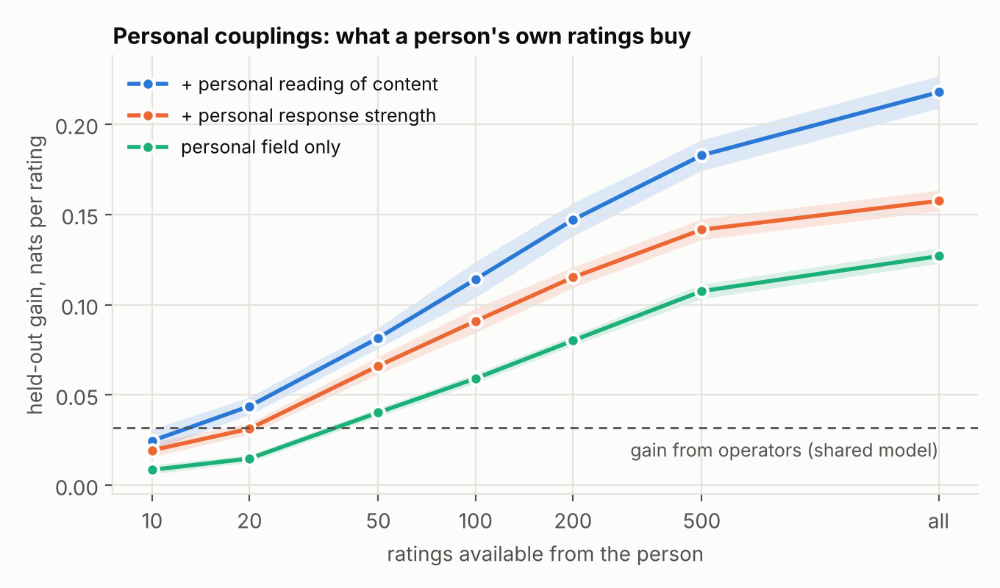

# Results — second pass: operators and particles

Run on 2026-11-14, CPU only. This pass follows the decision to narrow to the operator/particle structure found in `RESULTS.md`. Every number is held-out with a 95% paired-bootstrap interval; raw outputs are in `docs/results/` (`e1c_*anatomy*`, `e1c_*ablate*`, `e5_operators.json`, `e5b_short_list.json`, `e4_*.json`, `e2_*_gate_*`).

The model under test, for objects $x_i$ with one-body value $\phi(x_i)$ and one-body factor $m(x_i)$:

$$z=\Big[\prod_j m(x_j)\Big]\,\frac1N\sum_i W\phi(x_i),\qquad m(x)=1+2\tanh\delta(x)\in(-1,3)$$

"Gate" below means this model; $m=1$ is a particle with no operator action.

## 1. Summary

**Operators (the narrowed question).**

- On sentiment, the operator form accounts for the whole low-order interaction: adding a generic pair term on top gains +0.003 [−0.016, +0.018].
- Operators act forward. Backward-acting ones give no significant gain.
- The effect has a sparse head and a diffuse tail: the ten strongest words (never, without, n't, less, not, nor, no, …) recover roughly half of it when the model is refitted with them alone, though the interval is wide; the rest needs small factors on thousands of words.
- The factors transfer: frozen treebank factors work as well on a second dataset as factors learned there, and shuffled ones hurt.
- It is specific to valence in language. Arousal, dominance and concreteness show no operator structure; image tiles and tags show none.
- On categorical emotions (GoEmotions) a multiplicative gain exists (+0.030 to +0.057) but it is a different mechanism: the low factors belong to emotion words themselves, not to negators.

**Per-user couplings (brief §3.3), tested for the first time.**

- A rater-specific field on the concept nodes gains +0.192 nats per rating on held-out comments; adding a rater-specific response strength, +0.213; adding a rank-4 personal readout of content, +0.227. With rater identities shuffled the gain is 0.000. Training everything jointly gives +0.237.
- On the same scale, operators gain +0.032. **Personalisation is six to seven times larger than the best combination rule.**
- Most of it is the field (84%), which does not depend on content. The content-dependent personal part is +0.035, about the size of the operator effect.
- A new person, fitted from scratch with a prior learned from other people: 10 ratings gain +0.065, 20 gain +0.105, 50 gain +0.157.
- Rater fields are not low-dimensional in GoEmotions (about 9 effective dimensions of 28), but an 8-dimensional user space is ahead of the full field in point estimate when a person has 20 ratings or fewer.
- A second dataset with 7,912 people and about 17 ratings each confirms the pattern with tight intervals: a prior learned from other people makes even one rating useful, a prior that links the concept nodes is better still, and personal fields are small for plain sentiment and large for interpretive judgements.

Two numbers reported after the first version of this pass were wrong and are corrected here: the personal layers had been over-regularised, which understated the field (+0.127) and overstated the content readout (+0.060); and the reliability of per-rater operator strength is not robust (0.79 with per-node factors, 0.40 with scalar factors).

## 2. Anatomy on the sentiment treebank

60,000 training phrases of 2–12 words, 20,000 held-out, three seeds. Additive $R^2$ = 0.483.

| model | what it adds to the additive model | gain over additive |
|---|---|---|
| gate | commuting one-body factors | +0.0449 [+0.0300, +0.0609] |
| ordered gate, forward | a factor acts only on words after it | +0.0448 |
| ordered gate, backward | a factor acts only on words before it | +0.0128 [−0.0013, +0.0263] |
| ACE degree 2 | generic pair term | +0.0438 [+0.0282, +0.0609] |
| gate + ACE degree 2 | both | +0.0476 [+0.0285, +0.0679] |
| Deep Sets | any order | +0.0565 [+0.0391, +0.0785] |
| whole phrase through MPNet | any order, with word order and pretraining | +0.1016 [+0.0858, +0.1194] |

Paired differences:

| comparison | difference |
|---|---|
| gate + pair term over gate | +0.0028 [−0.0155, +0.0179] |
| forward-ordered over commuting gate | 0.0000 [−0.0070, +0.0064] |
| commuting gate over backward-ordered | +0.0321 [+0.0266, +0.0379] |
| gate over ACE degree 2 | +0.0011 [−0.0041, +0.0060] |
| Deep Sets over gate | +0.0116 [+0.0037, +0.0197] |
| whole-phrase MPNet over gate + pair term | +0.0540 [+0.0399, +0.0676] |

- **No pair structure is detectable once operators are in.** The generic second-order term and the operator form explain the same variance.
- **Operators act forward.** Restricting a factor to the words that follow it loses nothing; restricting it to the words before it loses about 70% of the gain. At these phrase lengths the commuting product is therefore as good as the ordered one.
- **The gain does not depend on the human word-sentiment feature.** Without it: additive $R^2$ 0.447, gate +0.0405, ACE degree 2 +0.0398.
- **About half of the structure a sentence encoder captures is still missing** (+0.054 beyond gate + pair). That part is neither operator-like nor a low-order set interaction in these descriptors.

## 3. How short can the operator list be?

Words are ranked by $|m-1|$ in the unrestricted model (words seen at least 25 times). The model is then refitted with only the top $k$ words allowed to carry a factor.

| operator words allowed | share of test tokens | gain over additive | share of the full gate's gain |
|---|---|---|---|
| 5 | 0.7% | +0.0128 [+0.0041, +0.0206] | 29% |
| 10 | 0.9% | +0.0213 [+0.0005, +0.0397] | 48% |
| 20 | 1.1% | +0.0220 [+0.0011, +0.0415] | 49% |
| 50 | 1.9% | +0.0263 [+0.0060, +0.0458] | 59% |
| 200 | 7.1% | +0.0281 [+0.0094, +0.0479] | 63% |
| all | 100% | +0.0449 [+0.0295, +0.0613] | 100% |

Learned factors of the top-ranked words: never −0.06, without −0.02, n't 0.04, less 0.09, not 0.10, nor 0.15, no 0.22, need 0.28, hardly 0.30, hate 0.34, rarely 0.40, devoid 0.45, none 0.46, barely 0.47, lack 0.49, only 0.53, neither 0.56; huge 1.47.

- **A sparse head and a diffuse tail.** Ten words give about half of the gain; going from 20 to 200 words adds only another 14 points; the last 37% needs small factors on thousands of words. The intervals on the restricted fits are wide (for ten words, 1% to 88% of the full gain), so "half" is a point estimate.
- This corrects the impression left by the first pass, where the top words looked like the whole effect. The strong negators are close to annihilators ($m \approx 0$): they reset the pooled value to the baseline rather than flip its sign. That negation is not a sign flip is known for this treebank (Zhu et al., ACL 2014, who found that neither reversal nor a constant shift models negators well).
- Switching operators off in the fitted model *without* refitting gives a similar picture (top 10: 37%, top 500: 56%).

## 4. Do operators transfer across datasets?

Factors learned on the treebank (movie-review sentiment) are frozen and applied to NRC two-word expressions (valence from a different rating study). Five-fold cross-fitting, three seeds.

| model on NRC valence | $R^2$ | gain over additive |
|---|---|---|
| additive | 0.572 | |
| gate learned on NRC | 0.578 | +0.0064 [−0.0012, +0.0137] |
| additive × frozen treebank factors | 0.577 | +0.0051 [−0.0032, +0.0137] |
| additive × treebank factors shuffled across words | 0.552 | −0.0200 [−0.0256, −0.0138] |
| additive with the treebank factor as an input feature only | 0.570 | −0.0013 [−0.0048, +0.0021] |

- Frozen treebank operators do as well as operators learned in-domain (difference −0.001 [−0.008, +0.006]), and shuffled ones hurt. The factors are a property of the words, not of the dataset.
- The operator gain itself is small on two-word expressions and not significant in this untuned run (the tuned first-pass run gave +0.0084 [+0.0026, +0.0143]).

## 5. Which concept nodes have operators?

| test bed, node | additive | gate, gain | ACE degree 2, gain |
|---|---|---|---|
| Treebank, sentiment | $R^2$ 0.483 | +0.0449 [+0.0300, +0.0609] | +0.0438 [+0.0282, +0.0609] |
| NRC two-word, valence | $R^2$ 0.578 | +0.0084 [+0.0026, +0.0143] | +0.0208 [+0.0139, +0.0279] |
| NRC two-word, arousal | $R^2$ 0.463 | −0.0004 [−0.0074, +0.0067] | +0.0063 [−0.0016, +0.0143] |
| NRC two-word, dominance | $R^2$ 0.527 | −0.0020 [−0.0084, +0.0040] | +0.0074 [−0.0015, +0.0159] |
| Two-word, concreteness | $R^2$ 0.570 | +0.0027 [−0.0020, +0.0068] | +0.0143 [+0.0075, +0.0200] |
| GoEmotions, 28 emotion labels | CE 1.986 | per-node factors +0.0443 [+0.0303, +0.0599]; one scalar factor +0.0296 [+0.0234, +0.0360] | +0.0385 [+0.0329, +0.0447] |
| Images, 4×4 tiles, emotion | CE 1.042 | −0.0570 [−0.0667, −0.0481] | +0.0076 [+0.0034, +0.0118] |
| Images, concept tags, emotion | CE 0.887 | −0.0137 [−0.0202, −0.0074] | +0.0028 [−0.0016, +0.0078] |

- **Operators are a valence phenomenon in language.** Arousal and dominance show none. Concreteness has a second-order effect that is *not* operator-like: it is carried by the pair ("logic bomb", "bad egg"), i.e. by lexicalised compounds.
- **Images show none.** The gated model is worse than the additive one on isolated tiles and on concept tags; no image element was found that acts on the rest.

## 6. Categorical emotions: a different multiplicative effect

GoEmotions: 57,921 Reddit comments, 3–5 raters each, target = the comment's distribution over 27 emotions + neutral. 46,366 training comments, 5,722 held-out, three seeds. Entropy of the targets (the floor for cross-entropy) is 0.836.

| model | cross-entropy | top-1 | gain over additive |
|---|---|---|---|
| additive | 1.986 | 50.3% | |
| gate, one factor per emotion node | 1.942 | 52.0% | +0.0443 [+0.0303, +0.0599] |
| gate, one scalar factor per word | 1.957 | | +0.0296 [+0.0234, +0.0360] |
| ordered gate, forward | 1.929 | 51.6% | +0.0572 [+0.0485, +0.0657] |
| ACE degree 2 | 1.948 | 51.0% | +0.0385 [+0.0329, +0.0447] |
| Deep Sets | 1.942 | 51.6% | +0.0439 [+0.0340, +0.0539] |
| whole comment through MPNet | 2.115 | 45.6% | −0.1292 [−0.1459, −0.1135] |

- Forward-ordered factors are the best model here: +0.019 [+0.011, +0.026] over the pair term and +0.013 [+0.003, +0.023] over Deep Sets. Over the commuting gate the difference is +0.013 [−0.003, +0.026], not significant.
- **The factors are not negators.** With one scalar factor per word, the lowest factors belong to emotion words: glad 0.60, appreciate 0.61, amazing 0.61, horrible 0.64, awesome 0.65, sorry 0.65, love 0.66. Neutral words sit at 1.00–1.06. My reading was saturation: a strong emotion word already decides the label, so further evidence must count for less than additively.
- **Direct test of that reading: partly supported.** Grouping held-out comments by the number of words with factor below 0.85 (one seed of each model):

| strong emotion words | share of comments | additive model's overconfidence in its top label | gain of the scalar gate | share of the total gain |
|---|---|---|---|---|
| 0 | 44% | +0.019 [+0.006, +0.031] | +0.015 [+0.009, +0.020] | 23% |
| 1 | 39% | +0.036 [+0.025, +0.049] | +0.029 [+0.021, +0.036] | 40% |
| 2 | 13% | +0.069 [+0.049, +0.089] | +0.022 [+0.003, +0.043] | 10% |
| 3 or more | 4% | +0.212 [+0.176, +0.247] | +0.189 [+0.109, +0.277] | 26% |

  The additive model becomes steadily more overconfident as strong words accumulate, and the gate's gain per comment is about ten times larger with three or more. But such comments are rare; 63% of the gain comes from comments with none or one, where the gate acts as a tempering of confidence rather than as saturation between words. The grouping uses the gate's own factors, so this is not an independent test.
- Agreement with the treebank's factors over 691 shared words is moderate (Spearman 0.43), and the two lists of 20 lowest factors share one word. So the *form* (one-body multiplicative factors, acting forward) carries over to categorical emotions; the *list* does not.
- With one factor per emotion node the factors are entangled with the sign of each node's baseline logit and cannot be read as damping or amplification; I do not interpret them.
- Isolated word embeddings beat the whole-comment sentence embedding here by a wide margin. Emotion labels on short comments are largely keyword-driven.

## 7. Per-user couplings

GoEmotions is the only open dataset here with rater identities: 207,542 ratings by 82 raters, of whom 62 have at least 500 ratings and get their own parameters. A rating is (comment, rater, label distribution). The shared model is frozen; a rater-specific layer is fitted on the training comments and scored on ratings of held-out comments (20,463 test ratings, intervals clustered by comment). The L2 strength on the personal parameters is chosen on validation ratings.

| layer on top of the shared logits $F(S)$ | parameters per rater | held-out gain, nats per rating |
|---|---|---|
| none (global recalibration only) | 0 | 0 (cross-entropy 2.054) |
| field: $F + b_u$ | 28 | +0.1915 [+0.1833, +0.1996] |
| + response strength: $(a+a_u)F + b_u$ | 56 | +0.2130 [+0.2045, +0.2211] |
| + personal readout of content: $+\,U_u V A(S)$, rank 4 | 168 | +0.2269 [+0.2170, +0.2365] |
| field, rater identities shuffled | 28 | −0.0002 [−0.0006, +0.0002] |
| rank-4 readout, rater identities shuffled | 168 | −0.0008 [−0.0016, −0.0001] |
| everything trained jointly on ratings (shared model 2.055) | 168 | +0.2372 [+0.2269, +0.2470] |

For comparison on the same scale, replacing the shared additive model by the shared gated one gains +0.032.

- Each step is significant, but the steps after the field are small: response strength over field +0.021 [+0.018, +0.025]; content readout over response strength +0.014 [+0.010, +0.018].
- Joint training adds about +0.01 over the two-stage fit, so the frozen shared model was not holding the result back.
- The field varies most across raters for curiosity, approval, disapproval and realization (standard deviation 0.8–1.0 in logit units).
- **Operator strength per rater.** Letting each rater scale the operators, $m_u = 1 + s_u(m-1)$, adds +0.0011 [+0.0003, +0.0020] with per-node factors and +0.0006 [+0.0002, +0.0010] with scalar factors. Its split-half reliability across raters is 0.79 and 0.40 respectively. So it is small, and not robustly a stable trait.

**User space.** On 47 development raters, the fitted fields have about 9 effective dimensions (participation ratio 9.5; the top 1 / 4 / 8 directions carry 22% / 56% / 74% of the variance). Constraining the field to $b_u = B e_u$ with $e_u \in \mathbb R^k$ recovers 41% / 57% / 70% / 87% of the full field's validation gain for $k$ = 1 / 2 / 4 / 8. People do not fall on a few axes.

**Cold start.** 15 raters are held out entirely. A new rater contributes $n$ ratings; only their $e_u$ (or $b_u$) is fitted, by MAP with a Gaussian prior whose width comes from the development raters and whose strength is chosen by simulating the same cold start on development raters. No personal validation set is used. Scored on the new raters' ratings of comments never used in training.

| ratings from the new person | full field (28 numbers) | 8-dim user space | 2-dim user space | 1-dim user space |
|---|---|---|---|---|
| 5 | +0.021 [−0.035, +0.055] | +0.048 [−0.012, +0.086] | +0.049 [−0.018, +0.091] | +0.039 [−0.019, +0.075] |
| 10 | +0.065 [+0.039, +0.084] | +0.091 [+0.063, +0.111] | +0.086 [+0.063, +0.104] | +0.071 [+0.048, +0.088] |
| 20 | +0.105 [+0.081, +0.124] | +0.119 [+0.095, +0.139] | +0.108 [+0.092, +0.125] | +0.097 [+0.082, +0.111] |
| 50 | +0.157 [+0.142, +0.173] | +0.155 [+0.142, +0.168] | +0.124 [+0.113, +0.136] | +0.109 [+0.099, +0.119] |
| 100 | +0.189 [+0.178, +0.200] | +0.170 [+0.159, +0.181] | +0.130 [+0.119, +0.140] | +0.113 [+0.102, +0.122] |
| 200 | +0.211 [+0.199, +0.221] | +0.179 [+0.168, +0.190] | +0.132 [+0.122, +0.142] | +0.114 [+0.105, +0.123] |

- Five ratings are not enough for a reliable gain. Ten ratings give twice the operator gain; fifty give five times.
- The user space is ahead at 20 ratings or fewer and behind from 50 on. The differences at small $n$ are within the intervals, which I did not test pairwise.
- Driving response strength and content readout from the same $e_u$ did worse than the field alone at every $n$.

Caveats specific to this section:

- A field on label logits mixes two things I cannot separate: how a person feels and how a person uses the label set. Since the field carries 84% of the gain, most of the measured personalisation could be label-use style. The content-dependent part (+0.035) is the cleaner evidence for "reads content differently", and it is small.
- The 15 new raters are one random draw; intervals are over their ratings, not over raters.
- These are paid annotators labelling Reddit comments, not users reacting to rendered concepts.
- That annotators differ systematically, and that modelling each annotator on a shared representation helps, is established (Davani et al., TACL 2022; verified in `PRIOR_ART.md`, section 2b). What is specific here is the size relative to combination rules and the cold-start curve.
- An earlier naive onboarding curve (`e4c_onboarding.json`: plain gradient descent with a fixed penalty and a personal validation set) is superseded by the cold-start table and understates small-$n$ gains.

### 7b. Second dataset: many people, few ratings each

Measuring Hate Speech (CC-BY-4.0): 135,556 ratings of 39,565 comments by 7,912 annotators, median 17 ratings each, on ten ordinal survey items used here as ten concept nodes. Only annotator ids are used. 2,347 annotators are held out as new people. The shared model is a cross-fitted ridge regression from a sentence embedding ($R^2$ 0.36), or that plus the shrunk mean residual of the other people who rated the same comment ($R^2$ 0.53). The personal layer is a field $b_u$; in this linear-Gaussian setting its cold-start estimate is closed-form, $\hat b_u = \Sigma_b(\Sigma_b+\Sigma_\varepsilon/n)^{-1}\bar r_u$, with both covariances estimated on the other 5,565 people.

Gain in mean squared error, in units of label variance, on the new person's remaining ratings (stronger shared model, "+crowd"):

| ratings from the new person | no prior (raw mean) | independent prior per node | prior with covariance between nodes | covariance over independent |
|---|---|---|---|---|
| 1 | −0.369 | +0.0073 [+0.0063, +0.0083] | +0.0118 [+0.0104, +0.0130] | +0.0045 [+0.0038, +0.0052] |
| 2 | −0.154 | +0.0127 [+0.0114, +0.0140] | +0.0180 [+0.0163, +0.0197] | +0.0053 [+0.0046, +0.0060] |
| 4 | −0.047 | +0.0212 [+0.0195, +0.0227] | +0.0263 [+0.0243, +0.0282] | +0.0051 [+0.0044, +0.0058] |
| 8 | +0.005 | +0.0305 [+0.0286, +0.0326] | +0.0346 [+0.0322, +0.0369] | +0.0040 [+0.0034, +0.0047] |
| 12 | +0.022 | +0.0357 [+0.0330, +0.0385] | +0.0395 [+0.0365, +0.0427] | +0.0037 [+0.0030, +0.0045] |

- **Personalisation from very few ratings works only with a prior.** Without one, the first ratings hurt badly; with one, a single rating already helps.
- **A user space helps here, significantly.** Letting the prior link the nodes gains 60% more than independent shrinkage at one rating and 10% more at twelve. The between-person covariance has about 3.6 effective dimensions of 10 (top direction 46%), so here people do fall on a few axes. Rank 4 is nearly as good as the full covariance; rank 1 is not.
- **Size.** Fields have standard deviation 0.08–0.39 across people against 0.6–0.8 of rating noise within a person. The most a perfectly known field could gain is about 0.05 of label variance (8% of what the weaker shared model leaves unexplained); twelve ratings reach about three quarters of that. This is a smaller effect than in GoEmotions.
- **Which nodes are personal.** Fields are smallest for sentiment and respect (0.08–0.10) and largest for dehumanize (0.39), status, violence and genocide (0.26–0.28). People agree on how positive a comment is and differ on the interpretive judgements.
- The same finding with the weaker shared model: +0.0091 at one rating and +0.0358 at twelve with the covariance prior.

## 8. What this means for the engine

1. **Personalise first.** Per-user couplings are worth six to seven times more than any combination rule tested, and the simplest form (a per-user field, one number per concept node) delivers 84% of it. This is the strongest quantitative support so far for the decision to make the grammar personal.
2. **Onboarding cost is low, given a prior.** Ten reactions from a new person, with a prior learned from other people, already beat the best shared model by twice the operator gain. Without a prior the first reactions make predictions worse. A user-space prior (covariance between concept nodes) is worth having for the first twenty or so reactions.
3. **What is personal is mostly the baseline.** The field does not depend on content. How content is read differs between people by about as much as operators matter. In this dataset the field may largely be label-use style; whether it reflects felt differences can only be settled with reactions from real users of the engine.
4. **Combination rule.** Combine concepts additively, then apply one-body multiplicative factors acting forward. For valence a short list of about ten negators gives roughly half of the available gain and can be built once and reused; a generic pair term adds nothing.
5. **Do not over-generalise the list.** It is specific to valence; for categorical emotions the multiplicative effect is saturation by emotion words; for arousal, dominance, concreteness and image regions there is none.
6. **The remaining gap is in the descriptors.** On sentiment a sentence encoder still explains about five more points of variance than any set model here. The ceiling is set by the one-body descriptors and by lexicalised units, not by the combination rule.

## 9. Caveats

- Three seeds throughout; the anatomy runs use default hyper-parameters (the tuned first-pass run had selected the defaults for every model).
- The ordering key for scoped operators is the relative position in the phrase. Syntactic scope was not modelled.
- The factor ranking uses words seen at least 25 times; rarer words can have large but unreliable factors.
- Image tests use tiles and CLIP tags, not annotated objects. The object-level test still needs Affection ∩ Visual Genome.
- The fitted gate being *worse* than additive on images is an optimisation outcome (it starts at the additive model); the finding is "no gain", not "harm".
- GoEmotions labels come from 3–5 raters per comment and have no noise ceiling here; its gated and Deep Sets fits stopped at the epoch limit, so their gains are slightly understated.

## 10. Open items

1. Affection ∩ Visual Genome (and EMOTIC): still the only route to an object-level image test, and Affection may also carry annotator identities for a second personalisation test (unconfirmed). Both need your access request.
2. A dedicated repository: I cannot create one from this session. Everything is on branch `claude/ml-beyond-llm-spike-7eblny` of `Personal_Website`.
3. Whether a personal field is feeling or label use: needs reactions from real users, ideally with a design that fixes the response format.
4. Personalisation has been tested on two annotation datasets, neither of them users reacting to rendered concepts.
